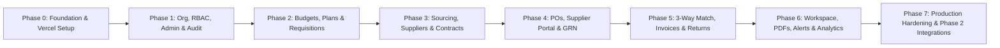

# Vensure — Phased Development Roadmap (Zero to Vercel Production)

Based on the [Vensure Project Overview](file:///c:/Users/HP/Desktop/Versaly%20Projects/Vensure%20Procurement%20MS/vensure-project-overview.md), this roadmap breaks down the 21 modules of the **Vensure Procurement Management System** into **8 logical, dependency-driven phases** designed specifically for a modern **Vercel** deployment architecture.

---

## Architecture & Recommended Vercel Tech Stack

To deploy smoothly on Vercel and support multi-tenancy, PDF generation, file storage, and background alerts without serverless bottlenecks, the following stack is recommended:

| Layer | Recommended Technology | Purpose |
| :--- | :--- | :--- |
| **Framework** | **Next.js (App Router, TypeScript)** | Full-stack React framework optimized for Vercel Edge & Serverless Functions |
| **UI & Styling** | **Tailwind CSS + shadcn/ui + Lucide Icons** | Enterprise-grade, accessible data tables, forms, modals, and dashboards |
| **Database & ORM** | **PostgreSQL (Neon or Supabase) + Prisma / Drizzle** | Relational integrity for 3-way matching, budget encumbrance, and ACID transactions |
| **Authentication** | **Auth.js (NextAuth v5) or Clerk / Better Auth** | Multi-tenant RBAC (7 internal roles + external Supplier Portal login) |
| **File Storage** | **Vercel Blob or AWS S3 / Cloudflare R2** | Storing supplier certs, contracts (PDF/DOCX), uploaded invoices, and branding assets |
| **PDF Generation** | **`@react-pdf/renderer`** | Generating branded PDFs for PRs, RFQs, POs, GRNs, Evaluation Reports, and Award Letters |
| **Email & Alerts** | **Resend + React Email + Vercel Cron** | Magic links for supplier quotes, approval emails, and scheduled expiry/deadline alerts |

---

## Phase 0: Project Foundation, Database & Early Vercel CI/CD
*Goal: Deploy a "walking skeleton" to Vercel on Day 1 so every subsequent feature is automatically tested in Vercel Preview deployments.*

### Deliverables
1. **Repository & Monorepo/App Setup**
   - Initialize Next.js (App Router, TypeScript, ESLint, Prettier, Tailwind CSS, `shadcn/ui`).
   - Configure folder structure: `src/app/(internal)`, `src/app/(supplier-portal)`, `src/app/api`, `src/lib`, `src/server/services`.
2. **Database & ORM Setup**
   - Provision serverless PostgreSQL (Neon or Supabase) with connection pooling enabled for Vercel Serverless.
   - Configure Prisma/Drizzle schema foundation and migration pipeline (`prisma migrate deploy` in Vercel build script).
3. **Vercel Pipeline**
   - Connect GitHub repository to Vercel for automatic Preview and Production deployments.
   - Configure environment variables (`DATABASE_URL`, `AUTH_SECRET`, `BLOB_READ_WRITE_TOKEN`, `RESEND_API_KEY`) across Development, Preview, and Production environments.

---

## Phase 1: Multi-Tenancy, RBAC, System Admin & Audit Trail
*Modules Covered: **#2 Organization & Multi-Tenancy**, **#20 System Administration (Core)**, **#4 Approval Workflows (Engine)***

> [!IMPORTANT]
> Every stage in Vensure requires **status, timestamps, responsible user, documents, and audit history**. Building the Audit Log and Approval Engine in Phase 1 prevents costly refactoring later.

### Deliverables
1. **Multi-Tenant Organization Model (Module 2)**
   - Schema for `Organization`, `Branch`, `Department`, and `CostCenter`.
   - White-label branding settings per tenant (logo, primary color, document header/footer details).
2. **Authentication & Role-Based Access Control (Module 2 & 20)**
   - Implement user invitation, activation/deactivation, and role assignment:
     - `Admin`, `Department Head`, `Procurement Officer`, `Finance`, `Approver`, `Viewer`, `Supplier`.
   - Route guards and server-action permission middleware scoped by `organizationId`.
3. **Immutable Audit Log Service (Module 2 & 20)**
   - Centralized audit wrapper (`logAuditEvent()`) capturing `actorId`, `action`, `entityType`, `entityId`, `before/after JSON diff`, `ipAddress`, and `timestamp`.
   - Admin Audit Log Viewer with filtering by user, module, and date range.
4. **Master Data & Catalog Setup (Module 20)**
   - Multi-currency and tax configuration (`Currency`, `ExchangeRate`, `TaxRate`).
   - Standard Item / Product Catalog with pre-filled specifications, units of measure, and categories.
5. **Reusable Approval Workflow Engine (Module 4)**
   - Configurable multi-level approval chains (e.g., `HOD → Procurement → Finance → MD`).
   - Amount threshold rules (e.g., `> $5,000` requires CFO sign-off).
   - Approval delegation (vacation cover with start/end dates) and full approval history timeline.

---

## Phase 2: Budgets, Procurement Planning & Requisitions
*Modules Covered: **#9 Budget Control & Commitment**, **#1 Procurement Planning**, **#5 Procurement Methods**, **#3 Purchase Requisition (PR)***

### Deliverables
1. **Budget Control & Encumbrance Engine (Module 9 — 🔴 High)**
   - Setup budgets per Department, Cost Center, and Period (`FiscalYear` / `Quarter`).
   - Implement the 4-layer budget state machine:
     - **Total Budget** $\rightarrow$ **Encumbered (Approved PRs)** $\rightarrow$ **Committed (Open POs)** $\rightarrow$ **Actual Spend (Paid Invoices)** = **Available Budget**.
   - Threshold warning triggers (e.g., 70% and 90% utilization).
2. **Procurement Methods Configuration (Module 5 — 🔴 High)**
   - Configure rules and mandatory document checklists for all 7 methods:
     - *Direct Purchase, RFQ, Competitive Quotation (min 3 quotes), Tender, Framework Agreement, Emergency Procurement, Single-Source*.
   - Enforce mandatory justification notes when deviating from a planned method or using Single-Source/Emergency bypasses.
3. **Procurement Planning (Module 1 — 🔴 High)**
   - Annual/periodic procurement plan builder with line items, estimated budget, target quarter, department, and planned method.
   - Plan approval workflow (`Planned → Active → Completed`) and dashboard for Planned vs. Actual execution.
4. **Purchase Requisition (PR) Lifecycle (Module 3 — Core)**
   - PR creation form linking to Department, Cost Center, Budget Line, Catalog Items, and (optionally) an active Procurement Plan item.
   - Status machine: `Draft → Submitted → Under Review → Approved / Rejected`.
   - Automatic **budget encumbrance** when a PR transitions to `Approved`.
   - Rejection with mandatory reason + revision and resubmission loop.

---

## Phase 3: Supplier Management, Sourcing (RFQ), Evaluation & Contracts
*Modules Covered: **#7 Supplier Management**, **#6 Request for Quotation (RFQ)**, **#8 Quotation Comparison & Selection**, **#10 Contract Management***

### Deliverables
1. **Supplier Management & Registry (Module 7 — Core)**
   - Supplier onboarding, tax ID/bank verification, approval status, and preferred/blacklist flags.
   - Supplier Document Vault (licenses, tax compliance, certifications with expiry dates) stored in Vercel Blob / S3.
2. **Request for Quotation — RFQ (Module 6 — Core)**
   - One-click RFQ generation from an approved PR.
   - Supplier invitation selector, submission deadline enforcement, and tracked clarification Q&A thread.
   - Status tracking: `Draft → Issued → Closed → Evaluated`.
3. **Quotation Comparison & Selection (Module 8 — Core)**
   - Side-by-side quotation comparison matrix.
   - Configurable weighted scoring engine (price, lead time, quality, past performance).
   - Mandatory selection justification + automatic **Override Alert** when the lowest-priced compliant quote is not selected.
4. **Contract Management (Module 10 — 🔴 High)**
   - Operational contract registry (`Draft → Active → Expiring → Expired → Terminated`) with version history and amendments.
   - Link contracts to suppliers, framework agreements, and call-off POs; track cumulative contract spend against contract ceiling value.

---

## Phase 4: Purchase Orders, External Supplier Portal & Goods Receipt (GRN)
*Modules Covered: **#11 Purchase Order (PO)**, **#12 Supplier Portal**, **#13 Goods Receipt Note (GRN)***

### Deliverables
1. **Purchase Order Management (Module 11 — Core)**
   - Auto-generate PO from awarded quotation or Framework Contract.
   - Transition budget from **Encumbered (PR)** to **Committed (PO)**.
   - PO versioning, amendment tracking, split delivery schedules, and status flow (`Draft → Issued → Acknowledged → Partially Delivered → Completed / Cancelled`).
2. **External Supplier Portal (Module 12 — 🟠 Medium / Major Differentiator)**
   - Dedicated, tenant-branded portal (`/[tenantSlug]/portal`) with supplier authentication.
   - Self-service profile/banking updates and compliance document uploads.
   - Live RFQ inbox: submit/revise quotes and respond to clarification requests.
   - PO inbox: accept/reject issued POs, confirm expected delivery dates, and view historical POs/payments.
3. **Goods Receipt Note — GRN (Module 13 — Core)**
   - Warehouse-friendly interface (no finance data exposed) to record deliveries against PO line items.
   - Support partial deliveries, shortage/damage/substitution flags, and photo/delivery-note uploads.
   - Status flow: `Pending → Partially Received → Fully Received`.

---

## Phase 5: Purchase Returns, 3-Way Matching & Invoice/Payment
*Modules Covered: **#14 Purchase Returns & Rejections**, **#15 Invoice & Payment***

### Deliverables
1. **Purchase Returns & Rejections (Module 14 — 🟠 Medium)**
   - Raise return notes directly from a GRN with reason codes (damaged, wrong spec, expired, short-dated).
   - Return workflow (`Raised → Approved → Dispatched → Acknowledged`).
   - Track replacement requests vs. Credit Notes, and auto-release committed budget upon accepted return.
2. **Automated 3-Way Matching Engine (Module 13 & 15 — Core)**
   - Automated line-by-line verification comparing **PO** (ordered qty & unit price) $\leftrightarrow$ **GRN** (accepted qty minus returns) $\leftrightarrow$ **Invoice** (billed qty & unit price).
   - Configurable tolerance thresholds and mismatch flagging with a dedicated exception resolution workflow.
3. **Invoice Approval & Payment Tracking (Module 15 — Core)**
   - Supplier invoice PDF upload and structured entry.
   - Credit note application, payment scheduling, partial payment recording, and status flow (`Pending → Approved → Scheduled → Paid`).
   - Transition budget from **Committed (PO)** to **Actual Spend (Paid Invoice)** and update Supplier Performance metrics (delivery timeliness, quality score from GRN/Returns, price competitiveness).

---

## Phase 6: Procurement Workspace, Document Templates, Alerts & Analytics
*Modules Covered: **#16 Procurement Documents & Templates**, **#17 Procurement Workspace**, **#18 Reporting & Analytics**, **#19 Notifications & Alerts***

### Deliverables
1. **Central Procurement Workspace (Module 17 — 🟢 Recommended)**
   - Live operational action command center featuring the 10 clickable urgency panels:
     - *New PRs, PRs Awaiting Action, Active RFQs, RFQs Closing Soon (<48h), Quotes Awaiting Evaluation, POs Awaiting Confirmation, Overdue Deliveries, Pending GRNs, Invoice Mismatches, Supplier Issues*.
   - Real-time filtering by department, category, and assigned procurement officer.
2. **Branded Document & PDF Template Engine (Module 16 — 🟠 Medium)**
   - Connected end-to-end Document Trail viewer on every transaction (`Plan → PR → RFQ → Quote → Evaluation → Award Letter → PO → GRN → Return → Invoice → Payment`).
   - Branded, version-controlled PDF generators for all 9 document types.
3. **Notifications & Scheduled Alerts (Module 19 — Core)**
   - In-app notification center + transactional emails via Resend.
   - **Vercel Cron Jobs** (`vercel.json` crons running daily/hourly) for:
     - Pending approval escalations, RFQs closing within 48h, overdue PO deliveries, contract renewal alerts (90/60/30 days), and expiring supplier certificates.
4. **Reporting & Analytics Suite (Module 18 — Core)**
   - Interactive charts and PDF/Excel (`xlsx`) exports for:
     - Spend analytics, PR-to-PO cycle time, Supplier spend concentration & performance scorecards, Budget vs. Committed vs. Actual, Plan vs. Actual, Pending approvals aging, Contract utilization, and 3-Way Match exceptions.

---

## Phase 7: Production Launch on Vercel & Phase 2 Integrations
*Modules Covered: **Production Hardening**, **#21 Integrations (Phase 2+)***

### Deliverables
1. **Security, Performance & QA Readiness**
   - End-to-end Playwright test suite covering the full lifecycle (`Plan → PR → RFQ → Quote → PO → GRN → 3-Way Match → Payment`).
   - Multi-tenant data isolation audit (ensuring zero cross-tenant data leakage).
   - Rate limiting (Upstash Redis / Vercel Firewall), custom domain & SSL setup, and automated database backups.
2. **Phase 2 Integrations (Module 21)**
   - **Accounting Webhooks/Sync**: QuickBooks Online, Xero, and Sage connectors for approved invoices and payments.
   - **SSO**: Google Workspace and Microsoft 365 Entra ID enterprise login.
   - **Messaging**: Twilio SMS and WhatsApp Business API notifications for urgent approvals and supplier alerts.
